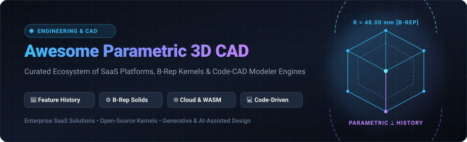

# 📐 Awesome Parametric 3D CAD

 

 

**A comprehensive, curated directory of SaaS platforms, desktop software, open-source repositories, and programmatic code-CAD engines.**  
*Focused on Feature-History Modeling, Exact B-Rep Solid Kernels, Constraint Solvers & Cloud/Browser-Native Design.*

---

## 📑 Table of Contents

- [🚀 Overview & Key Concepts](#-overview--key-concepts)
- [🌐 Sector Overview & Market Dynamics](#-sector-overview--market-dynamics)
- [🏢 SaaS & Commercial CAD Platforms](#-saas--commercial-cad-platforms)
- [🔓 Open-Source GitHub Projects](#-open-source-github-projects)
- [🧩 Programmatic Code-CAD & Python Automation](#-programmatic-code-cad--python-automation)
- [📈 Star History](#-star-history)
- [🤝 How to Contribute](#-how-to-contribute)
- [💖 Support & Sponsorship](#-support--sponsorship)
- [⚖️ Disclaimer](#-disclaimer)

---

## 🚀 Overview & Key Concepts

**Parametric 3D Computer-Aided Design (CAD)** is the backbone of mechanical engineering, aerospace development, product design, robotics, and additive manufacturing. Unlike mesh-based polygonal modeling software (such as Blender or 3ds Max), parametric CAD constructs watertight geometry through:

- **Feature-History Trees**: Sequential operations (sketches, extrusions, cuts, revolves, lofts, fillets, and chamfers) where modifying any dimension or constraint propagates downstream automatically without breaking model integrity.
- **Boundary Representation (B-Rep)**: Mathematical representations of solids bounded by exact analytical and NURBS surfaces, enabling sub-millimeter manufacturing tolerances and lossless STEP/IGES exchange.
- **Constraint Solvers**: 2D and 3D geometric constraint solvers (parallel, concentric, tangential, coincident) that enforce precise mechanical design intent.
- **Code-CAD & Computational Modeling**: Modern paradigms allowing engineers to define parts programmatically using Python, Rust, or JavaScript for version-controlled, repeatable design families.

---

## 🌐 Sector Overview & Market Dynamics

The global **3D CAD and Parametric Modeling software market** was valued at approximately **$12.5 Billion to $14.4 Billion in 2024–2025** and is projected to expand to **$17 Billion to $22 Billion by 2030–2032**, demonstrating a compound annual growth rate (**CAGR**) of **5.4% to 7.5%**.

The sector exhibits an **oligopolistic, highly concentrated structure at the enterprise tier**, where four legacy giants—**Siemens Digital Industries Software, Autodesk, Dassault Systèmes, and PTC**—capture over 70% of enterprise mechanical engineering and aerospace contracts. This concentration is heavily reinforced by decades of proprietary file formats, custom PLM (Product Lifecycle Management) workflows, and deep supply-chain integration. 

In parallel, the sector demonstrates **rapid fragmentation across the SMB, maker, and computational design segments**. High annual licensing costs ($2,500–$8,000+ per seat) have sparked a wave of innovation in **browser-native WebAssembly CAD** (e.g., Onshape, CycleCAD, CascadeStudio) and **modern open-source B-Rep engines** (FreeCAD, CadQuery, build123d, SolidCraft). Today, individual engineers and agile hardware startups can deploy production-grade parametric design stacks with zero per-seat licensing penalties.

---

## 🏢 SaaS & Commercial CAD Platforms

The table below lists leading commercial SaaS and hosted parametric CAD platforms, **sorted in descending order by company size, valuation, or annual revenue**.

| Product / Platform | Company Size (Valuation / Revenue) | Specific Starting Tier Pricing | Free Tier / Free Trial Limits | Key Capabilities & Target Use Case |
| :--- | :--- | :--- | :--- | :--- |
| **[Siemens NX](https://plm.sw.siemens.com/en-US/nx/)** | **~$155 Billion Market Cap** (Siemens AG: ~$82.5B Annual Revenue) | **$2,980 / user / year** *(NX X Design Standard SaaS bundle; ~$250/mo billed annually)* | **30-Day Cloud Free Trial** *(Instant browser-streamed access without local install; includes full CAD/CAM modules & preloaded sample parts; 1-year non-commercial student license available)* | 🏭 Enterprise-grade CAD/CAM/CAE for aerospace, automotive, and complex large assemblies with native Teamcenter PLM integration. |
| **[Autodesk Fusion 360](https://www.autodesk.com/products/fusion-360/)** | **~$62.4 Billion Market Cap** (Autodesk, Inc.: $6.01B Annual Revenue) | **$85 / month** or **$680 / year** *(or $2,040 for 3-year subscription)* | **Free for Personal Use (Free Forever)** *(Strictly non-commercial; capped at 10 active editable CAD documents, standard 2D/3D modeling, and 2.5/3-axis CAM; 1-user limit); 30-day full commercial trial* | 🛠️ Integrated CAD, CAM, and CAE workspace tailored for hobbyists, fabrication labs, CNC machinists, and rapid hardware prototyping. |
| **[SolidWorks](https://www.solidworks.com/)** | **~$35.2 Billion Market Cap** (Dassault Systèmes: ~$6.72B Annual Revenue) | **$2,700 / user / year** *(3DEXPERIENCE SOLIDWORKS Standard subscription; perpetual desktop is $4,195 + $1,495/yr maintenance; Maker tier is $48/yr)* | **14-Day Online Free Trial** *(Full in-browser evaluation without installation; includes parametric modeling, assemblies, and sheet metal); 7-to-30 day local desktop trial via certified VAR* | ⚙️ Global industry benchmark for mechanical product engineering, parametric assemblies, and production drawing workflows. |
| **[PTC Creo](https://www.ptc.com/en/products/creo)** | **~$22.8 Billion Market Cap** (PTC Inc.: $2.31B Annual Revenue) | **$2,780 / user / year** *(Creo Design Essentials Tier 1 annual subscription)* | **30-Day Free Trial** *(Node-locked desktop trial with full parametric modeling, assembly design, and technical drawings; export files watermarked for evaluation)* | 🚜 Heavy-duty parametric 3D CAD built for discrete manufacturing, advanced generative design, surfacing, and Windchill PLM pipelines. |
| **[Onshape](https://www.onshape.com/)** | **$470 Million Acquisition** (Division of PTC Inc., $22.8B Market Cap) | **$1,500 / user / year** *(Standard Plan billed annually; Professional Tier is $2,500/user/year)* | **Onshape Free Plan (Free Forever)** *(Free for non-commercial hobbyist use; full parametric modeling & unlimited documents, but **100% of created models are publicly visible and copyable**; 14-day Pro trial)* | 🌐 100% browser-native parametric CAD; runs on Chromebooks/Mac/Windows with built-in real-time team collaboration and continuous cloud version control. |
| **[Shapr3D](https://www.shapr3d.com/)** | **~$100 Million+ Valuation** ($8.7M VC funding raised; ~$10M–$15M ARR) | **$199.99 / year** *(Pro plan billed annually at ~$16.67/mo; or $37.99/mo on monthly billing)* | **Shapr3D Basic (Free Forever)** *(Limited to **2 active projects** at any time; export restricted to low-res STL and 3MF only—no high-res STEP/IGES/DWG; no 2D drawings; 14-day Pro trial)* | 📱 Mobile-first, multi-platform direct & parametric 3D CAD optimized for iPad with Apple Pencil, visionOS, macOS, and Windows. |

---

## 🔓 Open-Source GitHub Projects

The table below catalogs active, open-source parametric CAD systems, B-Rep geometric modelers, and computational CAD tools, **sorted in descending order by GitHub star count**.

| Project & Repository | GitHub Stars | License | Primary Stack | Core Description & Highlights |
| :--- | :---: | :---: | :---: | :--- |
| **[FreeCAD](https://github.com/FreeCAD/FreeCAD)** |  | LGPL-2.1 | C++, Python, Qt | 👑 **The premier open-source desktop parametric 3D CAD suite.** Full feature-history modeling via PartDesign workbench, constraint Sketcher, FEM simulation, modular CAM/Path workbenches, and rich Python scripting. Zero licensing fees or cloud dependencies. |
| **[OpenSCAD](https://github.com/openscad/openscad)** |  | GPL-2.0 | C++, OpenCSG | 💻 **The programmer's solid 3D CAD modeler.** Purely script-driven Constructive Solid Geometry (CSG). Models are defined entirely in declarative text files, making them ideal for Git version control, algorithmic designs, and 3D printing. |
| **[SolidCraft](https://github.com/tangency-labs/solidcraft)** |  | Apache-2.0 | Rust | 🦀 **AI-assisted parametric 3D CAD in pure Rust.** Features an integrated Model Context Protocol (MCP) server for agent-driven autonomous modeling, high-speed geometry generation, and cross-platform desktop/web delivery. |
| **[LibreCAD](https://github.com/LibreCAD/LibreCAD)** |  | GPL-2.0 | C++, Qt | 📐 **Mature cross-platform 2D computer-aided drafting system.** Reads and writes industry-standard DXF/DWG formats with full support for engineering layers, blocks, and hatching. Lightweight and runs smoothly on older hardware. |
| **[CadQuery](https://github.com/CadQuery/cadquery)** |  | Apache-2.0 | Python, OpenCASCADE | 🐍 **Python-native parametric CAD scripting framework.** Built upon the industrial OpenCASCADE (OCCT) B-Rep kernel. Enables engineers to design mechanical components programmatically, automate design families, and output STEP/STL files. |
| **[SolveSpace](https://github.com/solvespace/solvespace)** |  | GPL-3.0 | C++ | ⚡ **Ultra-lightweight, lightning-fast parametric 2D/3D CAD.** Renowned for its elegant, distraction-free constraint solver, rapid sketching workflow, assembly linkage analysis, and STEP/DXF export capabilities. |
| **[build123d](https://github.com/gumyr/build123d)** |  | Apache-2.0 | Python, OpenCASCADE | 🏗️ **Next-generation Python CAD programming library.** Designed with an intuitive, Pythonic API supporting both procedural and algebra-based geometry composition over OpenCASCADE B-Rep solids. |
| **[Blender CAD Sketcher](https://github.com/hlorus/CAD_Sketcher)** |  | GPL-3.0 | Python, C++ | 🎨 **Constraint-based parametric 2D/3D sketcher addon for Blender.** Powered by the SolveSpace geometric solver, bridging the gap between artistic subdivision modeling and dimensionally accurate engineering sketches. |
| **[Fornjot](https://github.com/hannobraun/fornjot)** |  | AGPL-3.0 | Rust | 🦀 **Next-generation B-Rep CAD kernel written in Rust.** Explores deterministic, code-first computational modeling with verifiable geometric contracts and modern systems programming paradigms. |
| **[Antimony](https://github.com/mkeeter/antimony)** |  | MIT | C++, Python, Qt | 🌌 **Graph/node-based parametric CAD from a parallel universe.** Replaces traditional boundary representation with functional representations (F-Rep) and compact computational graph nodes for rapid non-linear shape exploration. |
| **[jsketcher](https://github.com/xibyte/jsketcher)** |  | Apache-2.0 | JavaScript | 🌐 **Pure JavaScript browser-based parametric 2D and 3D modeler.** Features an interactive 2D geometric constraint solver, history tree extrusion, boolean solid operations, and in-browser STL generation. |
| **[CascadeStudio](https://github.com/zalo/CascadeStudio)** |  | MIT | JavaScript, WASM | 🧪 **Full live-scripted OpenCASCADE CAD kernel in the browser.** Compiles the OpenCASCADE B-Rep kernel to WebAssembly with real-time Monaco editor scripting, instant 3D viewport rendering, and STEP export. |
| **[Zoo Modeling App](https://github.com/KittyCAD/modeling-app)** |  | MIT | Rust, TypeScript | 🦁 **Code-first and UI-driven modern hardware design studio.** Built by Zoo (formerly KittyCAD) with a high-performance Rust graphics engine and KCL (KittyCAD Language) for programmatic hardware engineering. |
| **[CQ-Editor](https://github.com/CadQuery/CQ-editor)** |  | Apache-2.0 | Python, PyQt | 🖥️ **Interactive GUI and integrated development environment for CadQuery.** Provides live code execution, real-time 3D model inspection, parameter tuning, and step-by-step feature tree debugging. |
| **[Curv](https://github.com/curv3d/curv)** |  | Apache-2.0 | C++ | 🔮 **Functional programming language for mathematics and 2D/3D shapes.** Generates smooth procedural geometric objects using Signed Distance Fields (SDF) and exports to 3D printable meshes. |
| **[PartMode](https://github.com/BOMWiki/partmode)** |  | MIT | TypeScript, WASM | 📦 **Local-first, browser-native 3D parametric CAD for humans and AI agents.** Powered by OpenCascade WebAssembly for client-side solid modeling, typed tool calls, and automated mechanical assemblies. |
| **[CycleCAD](https://github.com/xupeiwust/cyclecad)** |  | MIT | JavaScript, WASM | 🚴 **Browser-based parametric 3D CAD modeler with AI-powered features.** Uses WebAssembly geometry routines, native Autodesk Inventor file parsing, and zero-installation cloud modeling. |

---

## 🧩 Programmatic Code-CAD & Python Automation

For engineering automation, generative part families, and Git-tracked CAD pipelines, several specialized libraries provide programmatic B-Rep control:

- **[CadQuery](https://github.com/CadQuery/cadquery)**: Pythonic wrapper over OpenCASCADE (OCCT) with fluent chaining syntax (`cq.Workplane("XY").box(10, 20, 30).faces(">Z").hole(5)`).
- **[build123d](https://github.com/gumyr/build123d)**: Modern alternative with context managers, algebraic operators, and explicit 1D/2D/3D object typing.
- **[OpenCASCADE Technology (OCCT)](https://dev.opencascade.org/)**: The foundational C++ geometric modeling kernel powering FreeCAD, KiCad, CadQuery, and industrial engineering suites worldwide.
- **[OpenCascade.js](https://github.com/donalffons/opencascade.js)**: Official Emscripten / WebAssembly port of OCCT, enabling browser-based client-side B-Rep solid modeling without server backends.

---

## 📈 Star History

---

## 🤝 How to Contribute

Contributions from engineers, makers, and software developers are warmly welcome! To add or update an entry:

1. **Fork** this repository.
2. Add your tool to either the **SaaS & Commercial CAD Platforms** table or the **Open-Source GitHub Projects** table following the existing format.
3. Ensure pricing and free tier limits are factual and specific (avoid generic placeholders).
4. For open-source repositories, include the shields.io social star badge linked to the stargazers page.
5. Submit a **Pull Request** with a concise description of why the tool is a fit.

---

## 💖 Support & Sponsorship

If you find this curated Parametric 3D CAD directory valuable for your engineering projects, research, or hardware startup, please consider showing your support:

- ⭐ **Star this repository** to help other engineers discover it.
- 🍴 **Fork it** to maintain your personal reference stack.
- 📢 **Share it** with mechanical design communities, hackspaces, and universities.
- ☕ **Sponsor the maintainer** to support ongoing updates and curated open-source development:

**👉 [Sponsor @ishandutta2007 on GitHub Sponsors](https://github.com/sponsors/ishandutta2007)**

---

## ⚖️ Disclaimer

- This is an independent, community-curated list and does not constitute an official endorsement of any commercial vendor or open-source software project.
- Pricing, seat tiers, and free trial terms are subject to change by respective software providers. Always check official vendor portals for current commercial quotations.
- Running self-hosted and open-source 3D CAD systems (such as FreeCAD or Blender) requires compatible OpenGL/Vulkan GPU drivers and sufficient system memory (16 GB+ recommended for complex assemblies). Standardize neutral interchange formats (STEP, IGES) for long-term project archiving.
